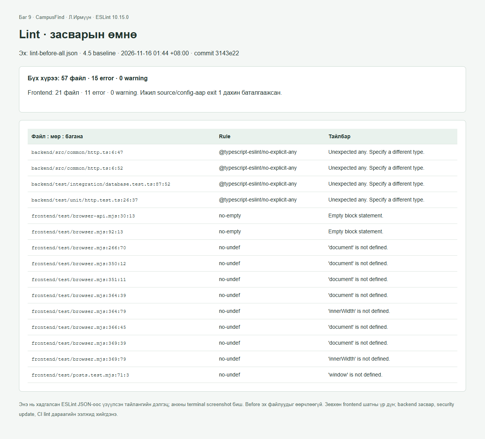
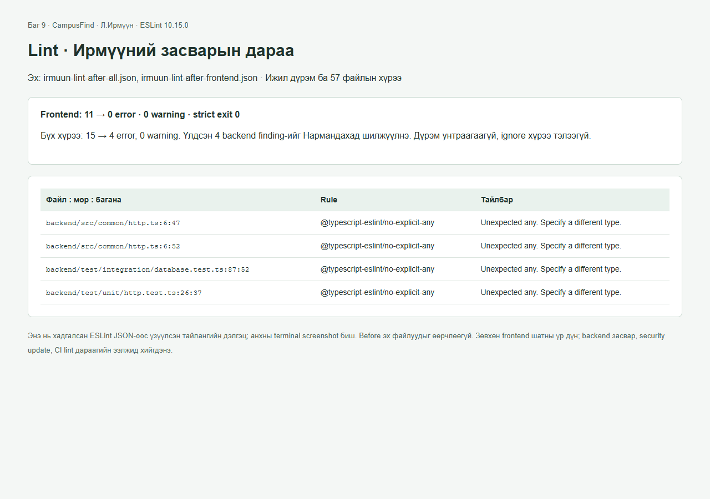

# Лаборатори 11 — Статик шинжилгээ, эмзэг байдал илрүүлэх

**Баг:** 9 · **Төсөл:** CampusFind / SWDP-2026-team9

**Огноо:** 2026-11-16

**Дараалал:** Л.Ирмүүн → Г.Нармандах → Э.Амарболд
**Суурь commit:** `3143e2210a2f243910d37160778c8e0ab959a86b`

## Зорилго ба хамрах хүрээ

ESLint-ээр кодын зөрчил илрүүлж засах, npm audit-аар dependency-ийн мэдэгдэж буй эмзэг байдлыг ангилах, lint-ийг CI-д нэгтгэх зорилготой. Тайланг гишүүн бүр өөрийн ээлжийн бодит үр дүнгээр нэмнэ. Одоогийн хэсэг нь Ирмүүний frontend ба tooling шатны үр дүн; Нармандах, Амарболдын ажил хүлээгдэж байна.

Хамрах хүрээ: frontend source/test/Vite config, backend source/test/scripts, database source, shared contracts, root scripts/config болон Лаб 7-ын JS. `node_modules`, `dist`, `coverage`, `uploads`, `.tmp`, `labs/lab11` нотолгоог lint-ээс хассан. Лаб 6-ын Python жишээ энэ JS/TS хүрээнд ороогүй.

| Хэрэгсэл                    | Шалгасан хувилбар |
| --------------------------- | ----------------- |
| Node / npm                  | 24.14.1 / 11.19.1 |
| ESLint / @eslint/js         | 10.15.0 / 10.0.1  |
| typescript-eslint / globals | 8.72.2 / 17.14.0  |
| TypeScript / Prettier       | 5.9.3 / 3.6.2     |

## Л.Ирмүүн — ESLint ба frontend

**Branch:** `lab11/irmuun-eslint-frontend`. **Кодын commit:** `a5fa9cc4da7de37d19fe580151028276c0178d95`. **PR:** [#29](https://github.com/IrmuunSolo/SWDP-2026-team9/pull/29). Код, нотолгоо ба локал шалгалт дууссан. Нармандахад (`Narmandah-cyber`) review хүсэлт өгсөн; approval ба merge хүлээгдэж байна.

### 4.1–4.5-ын хийсэн ажлыг шалгасан нь

1. Root lint/lint:fix script, package/lockfile ба flat config тохирсон, суулгасан tool version нь manifest-тай таарсан.
2. Initial root болон Лаб 7 audit JSON хүчинтэй (`auditReportVersion: 2`, metadata бий, registry error байхгүй). Root High 4, Лаб 7 — 0 байв.
3. Before JSON-д 57 файл, 15 error, 0 warning байна. Ижил source/config-аар дахин ажиллуулахад бүх file/line/column/rule/message таарсан, exit 1 болсон. Finding-тэй зургаан файлын JSON дахь source нь диск дээрх эхтэй таарсан.
4. `lint-before-meta.txt`-ийн exit code хоосон, stylish TXT-ийн кирилл path encoding буруу байсныг илрүүлсэн. Анхны нотолгоонуудыг өөрчлөлгүй хадгалж, баталгаажуулалтыг [irmuun-step-4-5-verification.json](../lab11/irmuun-step-4-5-verification.json)-д нэмсэн.
5. Config-ийг зөвхөн Prettier-ээр форматласан. Анхны byte SHA256 `c41c037546f536a9bddba0a613811dd9e1271a2addc5cbd940cb5df8e539fd1e`; форматласны дараах SHA256 `956b5aae1941709094cf6e9f62b5ce1df674d3a5cf8742a3b0ed485c146c9964`. Effective App config нь анхны print-config JSON-той ижил. Дүрэм унтраагаагүй, ignore хүрээ тэлээгүй.

Нотолгооны `.gitattributes` нь raw TXT болон initial JSON-ийн byte/encoding/line ending-ийг Git нормчлолоос хамгаална. Анхны хоосон exit code бүхий metadata, Prisma-ийн raw migration output доторх whitespace-ийг засаж нотолгоог өөрчлөөгүй; зөвхөн энэ хоёр capture-ийн diff-ийг binary хэлбэрээр үзүүлнэ. Уншихад зориулсан JSON, тайлан болон бусад текст нотолгоо нээлттэй хэвээр.

### Frontend засвар

Frontend-ийн 21 файлын 11 finding нь гурван тестийн файлд байсан; application source кодод lint finding гараагүй. Хоёр хоосон catch-д startup/readiness retry-ийн зориудын зан төлөвийг тайлбарласан. Browser callback дотор `globalThis.document`, `globalThis.innerWidth`, Node transport тестэд өөрөө үүсгэсэн `globalThis.window`-ийг ил тод хэрэглэсэн. Linter-д бүх тестийг browser globals-тай болгон зарлаагүй.

| №   | Before файл:мөр:багана                | Rule     | Шалтгаан ба хийсэн засвар                                                                                  |
| --- | ------------------------------------- | -------- | ---------------------------------------------------------------------------------------------------------- |
| 1   | `frontend/test/browser-api.mjs:30:13` | no-empty | API бэлэн болох хүртэл retry хийх catch-д зорилгыг тайлбарласан; deadline/error throw хэвээр               |
| 2   | `frontend/test/browser.mjs:92:13`     | no-empty | Vite startup retry catch-д тайлбар нэмсэн; retry тоо/хугацааг өөрчлөөгүй                                   |
| 3   | `frontend/test/browser.mjs:266:70`    | no-undef | Focus callback-ийн document-ийг `globalThis.document` болгосон; доорх focus race-ийг мөн хүлээлтээр зассан |
| 4   | `frontend/test/browser.mjs:350:12`    | no-undef | Upload retry-ийн эхний querySelector-ийг browser globalThis-оор авсан                                      |
| 5   | `frontend/test/browser.mjs:351:11`    | no-undef | Form aria-busy querySelector-ийг browser globalThis-оор авсан                                              |
| 6   | `frontend/test/browser.mjs:364:39`    | no-undef | Mobile list-ийн scrollWidth шалгалтад globalThis.document ашигласан                                        |
| 7   | `frontend/test/browser.mjs:364:79`    | no-undef | Mobile list-ийн viewport өргөнийг globalThis.innerWidth-ээр авсан                                          |
| 8   | `frontend/test/browser.mjs:366:45`    | no-undef | Keyboard activeElement шалгалтад globalThis.document ашигласан                                             |
| 9   | `frontend/test/browser.mjs:369:39`    | no-undef | Mobile form-ийн scrollWidth шалгалтад globalThis.document ашигласан                                        |
| 10  | `frontend/test/browser.mjs:369:79`    | no-undef | Mobile form-ийн viewport өргөнийг globalThis.innerWidth-ээр авсан                                          |
| 11  | `frontend/test/posts.test.mjs:71:3`   | no-undef | Node-д үүсгэсэн EventTarget-ийг `globalThis.window.addEventListener`-ээр ашигласан                         |

Эдгээр no-undef finding нь browser callback-ийг Node талаас статик шинжилж байгаатай холбоотой; browser-д document байхгүй гэсэн runtime алдаа гэж дүгнээгүй. Засвар нь execution context-ийг ил тод болгосон.

Browser regression-ийн эхний run-д form-ийн `requestAnimationFrame` дуусаагүй байхад focus-ийг уншдаг assertion унасан. `page.waitForFunction`-оор title input үнэхээр activeElement болохыг хүлээдэг болгож зассан; assertion-ийн шаардлагыг сулруулаагүй. [Эхний унасан run](../lab11/irmuun-browser-fixture.txt), [засварын дараах амжилттай run](../lab11/irmuun-browser-fixture-verified.txt)-ийг хоёуланг хадгалсан.

### Нэмсэн/өөрчилсөн файлууд

| Файл                                | Үүрэг                                                                                          |
| ----------------------------------- | ---------------------------------------------------------------------------------------------- |
| `eslint.config.mjs`                 | JS/TS recommended flat config; Prettier формат                                                 |
| `package.json`, `package-lock.json` | Суусан lint tooling, root lint/lint:fix script ба түгжсэн хувилбарууд                          |
| `frontend/test/browser-api.mjs`     | Readiness retry catch-ийн тайлбар                                                              |
| `frontend/test/browser.mjs`         | Startup retry, browser globals, animation-frame focus хүлээлт                                  |
| `frontend/test/posts.test.mjs`      | Node transport EventTarget global-ийг тодорхой ашиглах                                         |
| `labs/lab11/`                       | Анхны нотолгоо, verification, after lint, audit handoff, тестийн output, screenshot ба handoff |
| Энэ тайлан                          | Ирмүүний үр дүн ба дараагийн хоёр гишүүний бөглөх бүтэц                                        |

Backend, contracts, database/schema, migration, auth/App/client, CI workflow-д энэ шатанд өөрчлөлт хийгээгүй. Dependency security update/audit fix хийгээгүй.

## Lint: өмнө / Ирмүүний дараа

| Хүрээ                        | Файл | Өмнө error | Өмнө warning | Ирмүүний дараа error | Дараа warning | Дүн                                  |
| ---------------------------- | ---- | ---------- | ------------ | -------------------- | ------------- | ------------------------------------ |
| Бүх JS/TS хүрээ              | 57   | 15         | 0            | 4                    | 0             | Backend 4 үлдсэн; root strict exit 1 |
| Frontend                     | 21   | 11         | 0            | 0                    | 0             | Strict exit 0                        |
| Backend                      | 23   | 4          | 0            | 4                    | 0             | Нармандахад шилжүүлсэн               |
| Database                     | 6    | 0          | 0            | 0                    | 0             | Одоогийн scan finding 0              |
| Contracts                    | 1    | 0          | 0            | 0                    | 0             | Одоогийн scan finding 0              |
| Root scripts + ESLint config | 4    | 0          | 0            | 0                    | 0             | Одоогийн scan finding 0              |
| Лаб 7 JS                     | 2    | 0          | 0            | 0                    | 0             | Одоогийн scan finding 0              |

Нотолгоо: [before JSON](../lab11/lint-before-all.json), [before verification](../lab11/irmuun-lint-verification-before.json), [frontend after JSON](../lab11/irmuun-lint-after-frontend.json), [бүх хүрээний after JSON](../lab11/irmuun-lint-after-all.json), [UTF-8 readable root after](../lab11/irmuun-lint-after-all-readable.txt), [харьцуулалт](../lab11/irmuun-comparison.json).

Багийн эцсийн `lint-after-all.*` нь Амарболдын шатанд үүснэ. Энэ шатны файлуудыг эцсийн 0/0 гэж нэрлээгүй.

## Dependency audit — initial ба Ирмүүний handoff

| Lockfile / үе                             | Critical | High | Medium (moderate) | Low | Info | Exit / scan     |
| ----------------------------------------- | -------- | ---- | ----------------- | --- | ---- | --------------- |
| Root / lint tooling суухаас өмнөх initial | 0        | 4    | 0                 | 0   | 0    | 1 / хүчинтэй    |
| Root / tooling суусны дараах handoff      | 0        | 4    | 7                 | 0   | 0    | 1 / хүчинтэй    |
| Lab07 / initial                           | 0        | 0    | 0                 | 0   | 0    | 0 / хүчинтэй    |
| Lab07 / handoff                           | 0        | 0    | 0                 | 0   | 0    | 0 / хүчинтэй    |
| Амарболд / before-update, after           | —        | —    | —                 | —   | —    | Хүлээгдэж байна |

Эдгээр нь npm-ийн vulnerability node count; давхардалгүй advisory-ийн тоо биш. Root ба Лаб 7 тусдаа lockfile учраас хоёуланг шалгасан. Initial scan-ийн яг эхлэх timestamp анхны файлд тэмдэглэгдээгүй; суурь commit ба орчны мэдээлэл тусдаа бий. Handoff scan-ийн UTC timestamp, command, exit нь хажуугийн `.meta.json` файлд хадгалагдсан. Advisory database өөрчлөгдөж болох тул үеүүдийг нэг scan мэт нэгтгээгүй.

| Package / бүлэг                                                                                                            | Severity            | Шилжүүлэх ажил / owner                                                                                |
| -------------------------------------------------------------------------------------------------------------------------- | ------------------- | ----------------------------------------------------------------------------------------------------- |
| `@nestjs/platform-express`, `multer`                                                                                       | High                | Parent/upload dependency chain ба compatible update — Амарболд; Нармандах API review                  |
| `body-parser`                                                                                                              | High                | Parse/request chain, fixed range ба auth/posts regression — Амарболд, Нармандах                       |
| `zod`                                                                                                                      | High                | Fixed range, major migration-ийн contract/generated docs/consumer нөлөө — Амарболд, Нармандах, Ирмүүн |
| `typescript-eslint`, `@typescript-eslint/eslint-plugin`, `parser`, `type-utils`, `typescript-estree`, `utils`, `minimatch` | Medium, нийт 7 node | Tooling chain, safe fixed range ба peer compatibility — Амарболд                                      |

Raw advisory URL/range/fixAvailable нь [initial root](../lab11/audit-initial-root.json), [handoff root](../lab11/irmuun-audit-handoff-root.json)-д бий. [Lab07 handoff](../lab11/irmuun-audit-handoff-lab07.json) нь 0. npm-ийн автоматаар санал болгосон typescript-eslint хувилбарыг safe гэж батлаагүй; Амарболд advisory range/peer dependency-тай тулгаж update шийдвэр гаргана. `--force`/audit fix ажиллуулаагүй. Үлдсэн эрсдэлийн нарийвчилсан blocker/mitigation/owner/дуусгах огноог гуравдугаар ээлжид бөглөнө.

## Локал шалгалтын үр дүн — Ирмүүн

| Команд / урсгал                                     | Exit | Үр дүн / нотолгоо                                                                                                                              |
| --------------------------------------------------- | ---- | ---------------------------------------------------------------------------------------------------------------------------------------------- |
| `npx --no-install eslint frontend --max-warnings=0` | 0    | 21 файл, 0/0 — [output](../lab11/irmuun-lint-after-frontend.txt)                                                                               |
| `npm run build -w @campusfind/web`                  | 0    | TypeScript + Vite build — [output](../lab11/irmuun-frontend-build.txt)                                                                         |
| `npm run test -w @campusfind/web`                   | 0    | 4/4 — [output](../lab11/irmuun-frontend-tests.txt)                                                                                             |
| `npm run check`                                     | 0    | Build/typecheck, format, 34 contract, plan, layer boundary — [output](../lab11/irmuun-check-final.txt)                                         |
| `npm test`                                          | 0    | API 25/25 + Лаб 7 15/15 — [output](../lab11/irmuun-root-tests.txt)                                                                             |
| Fixture browser                                     | 0    | Chromium 1280×900, 390×844; history/race, validation/focus, upload retry, 401/403/501 — [output](../lab11/irmuun-browser-fixture-verified.txt) |
| `npm run test:integration`                          | 0    | Тусдаа tmpfs campusfind_test, 1/1 — [output](../lab11/irmuun-integration.txt)                                                                  |
| Бодит API/browser                                   | 0    | Login cookie, LOST/FOUND, detail/reload, planned 501, retry, logout revoke — [output](../lab11/irmuun-browser-api.txt)                         |
| Root strict lint                                    | 1    | Backend-ийн 4 finding үлдсэн; энэ шатанд хүлээгдэж буй үлдэгдэл                                                                                |
| `git diff --check`                                  | 0    | [output](../lab11/irmuun-diff-check.txt) — PASS                                                                                                |

Локал integration-д `campusfind-lab11-irmuun-test-db` нэртэй, `127.0.0.1:15432` порттой түр PostgreSQL 17, зөвхөн `campusfind_test` ашигласан. Development DB/volume-д хүрээгүй. Test user/posts-ийг тест цэвэрлэсэн. SMTP delivery болон шинэ Compose image build шалгаагүй.

Browser fixture-ийн зориудын HTTP/network алдаанаас 13 resource console error гарсан; тайлбарлагдаагүй console warning/error болон pageerror 0. Browser upload/search-ийн амжилттай нөхцөл fixture, бодит API дээр 501 гэдгийг тусад нь тэмдэглэсэн.

## Ирмүүний PR ба алсын CI

Кодын `a5fa9cc` commit дээр PR-ийн хоёр workflow амжилттай дууссан:

- [CampusFind CI run 43744475007](https://github.com/IrmuunSolo/SWDP-2026-team9/actions/runs/43744475007) — `CampusFind checks` PASS.
- [CampusFind Foundation run 43744474941](https://github.com/IrmuunSolo/SWDP-2026-team9/actions/runs/43744474941) — install/generate, build/static checks, unit/HTTP tests, тусдаа DB migration/PostgreSQL integration PASS.

Бодит API-аас авсан run/job/step snapshot: [irmuun-remote-ci.json](../lab11/irmuun-remote-ci.json). Энэ нь дээрх кодын commit-ийн нотолгоо; CI-ийн тайлан/холбоос нэмсэн дараагийн commit-ийн төлөвийг PR-ийн Checks-ээс тусад нь шалгана. Root lint CI-д хараахан холбогдоогүй учраас эдгээр workflow-ийн PASS нь backend-ийн 4 lint finding арилсан гэсэн үг биш.

Тусдаа tmpfs test контейнерийг ID-г нь шалгаж зогсоож устгасан; development volume хэвээр. Нармандах review хийж PR main-д merge болсны дараа дараагийн ээлжээ эхлүүлнэ.

## Г.Нармандах — Backend ба shared код

**Төлөв: Хүлээгдэж байна.** Өөрийн branch/PR, засвар, before/after, command/exit, тестийн дүнг ээлждээ нэмнэ.

| Үлдсэн файл:мөр:багана                            | Rule / тоо         |
| ------------------------------------------------- | ------------------ |
| `backend/src/common/http.ts:6:47`, `:6:52`        | no-explicit-any ×2 |
| `backend/test/integration/database.test.ts:87:52` | no-explicit-any ×1 |
| `backend/test/unit/http.test.ts:26:37`            | no-explicit-any ×1 |

## Э.Амарболд — Audit, database ба CI

**Төлөв: Хүлээгдэж байна.** Database-ийн incoming scan, before-update/after audit, advisory ангилал, version update эсвэл blocker/mitigation/owner/хугацаа, `.github/workflows/ci.yml` lint алхам, CI run URL/head SHA-г ээлждээ нэмнэ. Ирмүүний шатанд workflow өөрчлөгдөөгүй.

## Нотолгооны зураг

Доорх хоёр зураг нь хадгалсан ESLint JSON-ийг HTML тайлангаар үзүүлсэн screenshot; анхны PowerShell цонхны screenshot биш. JSON ба HTML эхийг хамт хадгалсан. Ингэснээр before finding-ийг засварын дараа дахин зохиохгүйгээр уншиж болно.

Browser regression-ийн [desktop](../lab11/irmuun-browser/desktop.png), [mobile](../lab11/irmuun-browser/mobile.png), [mobile form](../lab11/irmuun-browser/mobile-form.png) зургууд мөн бий.

## Дараагийн хүнд хүлээлгэн өгөх

[IRMUUN_HANDOFF.md](../lab11/IRMUUN_HANDOFF.md)-д Нармандахын яг засах файлууд, audit-ийн Амарболдод шилжүүлэх жагсаалт, нотолгооны тайлбар бий. Frontend шат дууссан; бүх лабораторийг Done гэж тооцохын өмнө backend үлдэгдэл, dependency remediation, CI lint ба эцсийн review дуусах шаардлагатай.
