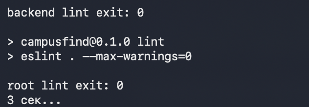

# Лаборатори 12 — Статик шинжилгээ, эмзэг байдал илрүүлэх

**Баг:** 9 · **Төсөл:** CampusFind / SWDP-2026-team9

**Огноо:** 2026-11-16 · **Дараалал:** Л.Ирмүүн → Г.Нармандах → Э.Амарболд

**Суурь commit:** `3143e2210a2f243910d37160778c8e0ab959a86b`

## Зорилго ба хамрах хүрээ

ESLint-ээр кодын зөрчил илрүүлж засах, npm audit-аар dependency-ийн мэдэгдэж буй эмзэг байдлыг ангилах, lint-ийг CI-д нэгтгэх зорилготой. Ирмүүн frontend ба tooling, Нармандах backend/shared засвар, Амарболд audit/database/CI шатыг гүйцэтгэсэн.

Lint хүрээ: frontend source/test/Vite config, backend source/test/scripts, database source, contracts, root scripts/config, Лаб 7-ын JS. Dependency, build output, coverage, uploads, .tmp, Лаб 12-ийн нотолгоог lint-ээс хассан. Дүрэм унтраах буюу ignore хүрээ тэлж зөрчлийг нуугаагүй.

| Хэрэгсэл                    | Хувилбар          |
| --------------------------- | ----------------- |
| Node / npm                  | 24.14.1 / 11.19.1 |
| ESLint / @eslint/js         | 10.15.0 / 10.0.1  |
| typescript-eslint / globals | 8.72.2 / 17.14.0  |
| TypeScript / Prettier       | 5.9.3 / 3.6.2     |

## Л.Ирмүүн — ESLint ба frontend — Хийгдсэн

**Branch:** `lab12/irmuun-eslint-frontend`. **Кодын commit:** `a5fa9cc`. **PR:** [#29](https://github.com/IrmuunSolo/SWDP-2026-team9/pull/29). Энэ PR-д Нармандахын review-г заавал нөхцөл болгохгүй; хамгийн сүүлийн commit-ийн CI амжилттай болсны дараа нэгтгэнэ.

### 4.1–4.5-ын баталгаажуулалт

Root lint/lint:fix, package/lockfile, flat config ба tool version-ийг шалгасан. Before JSON-д 57 файл, 15 error, 0 warning байна. Ижил source/config-аар давтахад file/line/column/rule/message бүгд таарч, exit 1 болсон. Finding-тэй зургаан файлын хадгалсан source нь тухайн үеийн эхтэй таарсан.

Анхны metadata-д exit code хоосон, stylish TXT-д кирилл path encoding зөрүү байсан. Үүнийг [verification](../lab12/irmuun-verification.json)-д тэмдэглэж, хүчинтэй before JSON болон initial audit JSON-ийг byte өөрчлөлтгүй хадгалсан. Config-ийг зөвхөн Prettier-ээр форматласан; byte hash өөрчлөгдсөн ч effective App config ижил болохыг шалгасан. Hash, tool version, харьцуулалт ба scan metadata мөн verification файлд бий.

### Frontend засвар

Frontend-ийн 21 файлын 11 finding нь гурван тестийн файлд байсан; application source кодод lint finding гараагүй. Хоёр хоосон catch-д startup/readiness retry-ийн зориудын зан төлөвийг тайлбарласан. Browser callback дотор `globalThis.document`, `globalThis.innerWidth`, Node transport тестэд өөрөө үүсгэсэн `globalThis.window`-ийг ил тод хэрэглэсэн. Linter-д бүх тестийг browser globals-тай болгон зарлаагүй.

| №   | Before файл:мөр:багана                | Rule     | Шалтгаан ба хийсэн засвар                                                                                  |
| --- | ------------------------------------- | -------- | ---------------------------------------------------------------------------------------------------------- |
| 1   | `frontend/test/browser-api.mjs:30:13` | no-empty | API бэлэн болох хүртэл retry хийх catch-д зорилгыг тайлбарласан; deadline/error throw хэвээр               |
| 2   | `frontend/test/browser.mjs:92:13`     | no-empty | Vite startup retry catch-д тайлбар нэмсэн; retry тоо/хугацааг өөрчлөөгүй                                   |
| 3   | `frontend/test/browser.mjs:266:70`    | no-undef | Focus callback-ийн document-ийг `globalThis.document` болгосон; доорх focus race-ийг мөн хүлээлтээр зассан |
| 4   | `frontend/test/browser.mjs:350:12`    | no-undef | Upload retry-ийн эхний querySelector-ийг browser globalThis-оор авсан                                      |
| 5   | `frontend/test/browser.mjs:351:11`    | no-undef | Form aria-busy querySelector-ийг browser globalThis-оор авсан                                              |
| 6   | `frontend/test/browser.mjs:364:39`    | no-undef | Mobile list-ийн scrollWidth шалгалтад globalThis.document ашигласан                                        |
| 7   | `frontend/test/browser.mjs:364:79`    | no-undef | Mobile list-ийн viewport өргөнийг globalThis.innerWidth-ээр авсан                                          |
| 8   | `frontend/test/browser.mjs:366:45`    | no-undef | Keyboard activeElement шалгалтад globalThis.document ашигласан                                             |
| 9   | `frontend/test/browser.mjs:369:39`    | no-undef | Mobile form-ийн scrollWidth шалгалтад globalThis.document ашигласан                                        |
| 10  | `frontend/test/browser.mjs:369:79`    | no-undef | Mobile form-ийн viewport өргөнийг globalThis.innerWidth-ээр авсан                                          |
| 11  | `frontend/test/posts.test.mjs:71:3`   | no-undef | Node-д үүсгэсэн EventTarget-ийг `globalThis.window.addEventListener`-ээр ашигласан                         |

Эдгээр no-undef finding нь browser callback-ийг Node талаас статик шинжилж байгаатай холбоотой; browser-д document байхгүй гэсэн runtime алдаа гэж дүгнээгүй. Засвар нь execution context-ийг ил тод болгосон.

Browser regression-ийн эхний run-д form-ийн `requestAnimationFrame` дуусаагүй байхад focus-ийг уншдаг assertion унасан. `page.waitForFunction`-оор title input үнэхээр activeElement болохыг хүлээдэг болгож зассан; assertion-ийн шаардлагыг сулруулаагүй. [Эхний унасан run](../lab12/irmuun-checks.txt), [засварын дараах амжилттай run](../lab12/irmuun-checks.txt)-ийг хоёуланг хадгалсан.

### Өөрчилсөн код

`eslint.config.mjs`, root package/lockfile, `frontend/test/browser-api.mjs`, `frontend/test/browser.mjs`, `frontend/test/posts.test.mjs`. Backend, database/schema, shared contract, migration, auth/App/client, CI workflow-д энэ шатанд өөрчлөлт хийгээгүй. Dependency security update/audit fix хийгээгүй.

## Lint: өмнө / Ирмүүний дараа

| Хүрээ                 | Файл | Өмнө error | Дараа error | Warning | Дүн                                 |
| --------------------- | ---- | ---------- | ----------- | ------- | ----------------------------------- |
| Бүх JS/TS             | 57   | 15         | 4           | 0       | Root strict exit 1 — backend үлдсэн |
| Frontend              | 21   | 11         | 0           | 0       | Strict exit 0                       |
| Backend               | 23   | 4          | 4           | 0       | Нармандахын ээлж                    |
| Database              | 6    | 0          | 0           | 0       | Энэ scan-аар finding 0              |
| Contracts             | 1    | 0          | 0           | 0       | Энэ scan-аар finding 0              |
| Root scripts + config | 4    | 0          | 0           | 0       | Энэ scan-аар finding 0              |
| Лаб 7 JS              | 2    | 0          | 0           | 0       | Энэ scan-аар finding 0              |

[Before JSON](../lab12/lint-before-all.json), [after JSON](../lab12/irmuun-lint-after-all.json), [харьцуулалт ба баталгаа](../lab12/irmuun-verification.json). Багийн эцсийн lint 0/0 дүнг Амарболдын ээлжид нэмнэ.

## Dependency audit

| Lockfile / үе                    | Critical | High | Medium (moderate) | Low | Info | Exit            |
| -------------------------------- | -------- | ---- | ----------------- | --- | ---- | --------------- |
| Root / tooling-оос өмнөх initial | 0        | 4    | 0                 | 0   | 0    | 1               |
| Root / tooling орсон handoff     | 0        | 4    | 7                 | 0   | 0    | 1               |
| Lab07 / initial                  | 0        | 0    | 0                 | 0   | 0    | 0               |
| Lab07 / handoff                  | 0        | 0    | 0                 | 0   | 0    | 0               |
| Амарболд / before-update, after  | —        | —    | —                 | —   | —    | Хүлээгдэж байна |

Бүх scan хүчинтэй. Эдгээр тоо нь vulnerability node count; давхардалгүй advisory-ийн тоо биш. Initial scan-ийн яг эхлэх timestamp анх тэмдэглэгдээгүй. Handoff scan-ийн timestamp/exit ба tool мэдээлэл verification-д хадгалагдсан. Advisory database өөрчлөгдөж болох тул үеүүдийг нэг scan гэж үзээгүй.

- High: `@nestjs/platform-express`, `body-parser`, `multer`, `zod` — Амарболд update, Нармандах API/validation review; Zod major update-д Ирмүүн consumer review.
- Medium: `typescript-eslint`, `@typescript-eslint/eslint-plugin`, `parser`, `type-utils`, `typescript-estree`, `utils`, `minimatch` — нийт 7 node; Амарболд tooling chain ба нийцлийг шалгана.
- npm-ийн `fixAvailable` саналыг safe гэж шууд батлаагүй. Advisory/fixed range/peer requirement-ийг тулгана. Үлдсэн бүрийн blocker/mitigation/owner/хугацааг гуравдугаар ээлжид бөглөнө.

Raw audit: [root initial](../lab12/audit-initial-root.json), [Lab07 initial](../lab12/audit-initial-lab07.json), [root handoff](../lab12/irmuun-audit-handoff-root.json), [Lab07 handoff](../lab12/irmuun-audit-handoff-lab07.json).

## Шалгалт ба CI — Ирмүүн

Команд/эхлэх-дуусах цаг/exit/output-ийг [irmuun-checks.txt](../lab12/irmuun-checks.txt)-д нэгтгэсэн. Давхар meta файл болон command-only хоосон log хадгалаагүй.

| Шалгалт                            | Үр дүн                                                                                      |
| ---------------------------------- | ------------------------------------------------------------------------------------------- |
| Frontend strict lint               | Exit 0, 0 error / 0 warning                                                                 |
| Frontend build, npm run check      | PASS: build/typecheck, format, 34 contract, plan, layer boundary                            |
| Frontend unit/transport            | 4/4                                                                                         |
| npm test                           | API 25/25 + Лаб 7 15/15                                                                     |
| Fixture browser                    | PASS: Chromium 1280×900, 390×844; history/race, validation/focus, upload retry, 401/403/501 |
| Тусдаа campusfind_test integration | 1/1                                                                                         |
| Бодит API/browser                  | PASS: login cookie, LOST/FOUND, detail/reload, planned 501, retry, logout revoke            |
| Root strict lint                   | Exit 1: backend-ийн 4 finding үлдсэн                                                        |
| git diff --check                   | PASS                                                                                        |

Эхний browser focus assertion race-ийн унасан ба засварын дараах амжилттай run хоёул нэгтгэсэн output-д бий. Fixture-ийн зориудын HTTP/network request-ээс 13 resource console error; тайлбарлагдаагүй console warning/error ба pageerror 0. Upload/search амжилт нь fixture; бодит API planned 501. SMTP, шинэ Compose build шалгаагүй. Түр tmpfs campusfind_test контейнерийг цэвэрлэсэн; development DB/volume-д хүрээгүй.

Кодын `a5fa9cc` дээр [CampusFind CI](https://github.com/IrmuunSolo/SWDP-2026-team9/actions/runs/43744475007), [Foundation](https://github.com/IrmuunSolo/SWDP-2026-team9/actions/runs/43744474941) PASS. Тайлангийн `3e2c2bf` дээр [CampusFind CI](https://github.com/IrmuunSolo/SWDP-2026-team9/actions/runs/43744748988), [Foundation](https://github.com/IrmuunSolo/SWDP-2026-team9/actions/runs/43744748929) мөн PASS. [Кодын commit-ийн run/job/step snapshot](../lab12/irmuun-remote-ci.json). Цэвэрлэгээний хамгийн сүүлийн commit-ийн CI-г PR-ийн Checks-ээр батална. CI-д lint нэмэх ажил Амарболдын ээлжид тул CI ногоон нь backend-ийн lint finding арилсан гэсэн үг биш.

## Г.Нармандах — Backend/shared — Хийгдсэн

**Branch:** `lab12/narmandakh-static-fixes` · **Суурь:** main `7fe1252` · **PR:** [#31](https://github.com/IrmuunSolo/SWDP-2026-team9/pull/31) (merge `ed8bc0b`), review: Э.Амарболд

### Ирсэн төлөв

Ирмүүний PR #29 main-д нэгтгэгдсэний дараа main-аа шинэчилж root lint ажиллуулахад 57 файлд **4 error / 0 warning**, exit 1 гарсан нь Ирмүүний үлдээсэн жагсаалттай яг таарсан. Бүгд backend-ийн `@typescript-eslint/no-explicit-any` дүрэм. Contracts, database, root scripts, Лаб 7-д finding гараагүй. [Ирсэн төлөв](../lab12/narmandakh-lint-incoming.txt).

### Засвар

| №   | Before файл:мөр:багана                            | Rule               | Шалтгаан ба засвар                                                                                                                                                                                                                                                                                 |
| --- | ------------------------------------------------- | ------------------ | -------------------------------------------------------------------------------------------------------------------------------------------------------------------------------------------------------------------------------------------------------------------------------------------------- |
| 1–2 | `backend/src/common/http.ts:6:47`, `:6:52`        | no-explicit-any ×2 | Бүх controller-ийн оролтыг шалгадаг `parse()`-ийн схемийн төрөл `z.ZodType<T, any, any>` байсан нь def болон input төрлийн шалгалтыг бүрэн унтрааж байв. `z.ZodType<T, z.ZodTypeDef, unknown>` болгосон. Input `unknown` тул `z.coerce` зэрэг input/output өөр схемийг хүлээн авч, гаралтын `T` зөв гарна. Validation болон 400 `VALIDATION_ERROR` хариу өөрчлөгдөөгүй. |
| 3   | `backend/test/integration/database.test.ts:87:52` | no-explicit-any ×1 | Зарлалын жагсаалтаас үүсгэсэн зарлалыг хайхдаа `(p: any)` хэрэглэж байсныг тестийн ашигладаг цорын ганц талбараар `(p: { id: string })` болгосон.                                                                                                                                                  |
| 4   | `backend/test/unit/http.test.ts:26:37`            | no-explicit-any ×1 | Session mock-ийн `findUnique({ where }: any)`-ийг Prisma-гийн дуудлагын хэлбэрээр `{ where: { tokenHash: string } }` болгосон.                                                                                                                                                                      |

Production кодын өөрчлөлт нь зөвхөн төрлийн тодорхойлолт. Validation логик, API contract, response, session/CSRF хамгаалалт өөрчлөгдөөгүй. Дүрэм унтраагаагүй, `eslint-disable` болон ignore нэмээгүй. Diff-ээр public response-д бүтэн оюутны код, hash, token нэмэгдээгүй, actor session-ээс авагдсан хэвээр болохыг шалгасан.

### Lint: өмнө / дараа

| Хүрээ                                 | Өмнө error | Дараа error | Warning | Exit |
| ------------------------------------- | ---------- | ----------- | ------- | ---- |
| Backend + contracts + scripts + Лаб 7 | 4          | 0           | 0       | 0    |
| Бүх JS/TS (root `npm run lint`)       | 4          | 0           | 0       | 0    |

Database-д lint finding 0 тул Амарболдод шилжүүлэх database lint үлдэгдэл байхгүй. [Засварын дараах lint](../lab12/narmandakh-lint-after.txt).

### Шалгалт

| Шалгалт                           | Үр дүн                                                                    |
| --------------------------------- | ------------------------------------------------------------------------- |
| `npm run check`                   | PASS: build/typecheck, Prettier, 34 API гэрээ, plan, layout               |
| `npm test`                        | API unit 25/25, Лаб 7 15/15                                               |
| `npm run test -w @campusfind/web` | 4/4                                                                       |
| `git diff --check`                | PASS                                                                      |
| PostgreSQL integration            | Засвар нь зөвхөн төрлийн тэмдэглэгээ тул PR-ийн Foundation CI-аар батална |

[Команд ба exit код](../lab12/narmandakh-checks.txt).

### Dependency audit-ийн backend нөлөө (Амарболдод)

Update хийгээгүй, root lockfile-д энэ шатанд хүрээгүй. Энэ шатны scan-д advisory database шинэчлэгдэж root дүн 7 moderate, 7 high болсон: Ирмүүний handoff-оос хойш `prisma`, `@prisma/config`, `effect` High болж нэмэгдсэн. [Audit тэмдэглэл](../lab12/narmandakh-audit-note.txt).

| Package (суусан → засагдсан)                      | Хамаарал                                                         | Backend-д хүрэх эсэх                                                                                                                                  | Санал ба шалгах урсгал                                                                                                                                                                                    |
| ------------------------------------------------- | ---------------------------------------------------------------- | ----------------------------------------------------------------------------------------------------------------------------------------------------- | --------------------------------------------------------------------------------------------------------------------------------------------------------------------------------------------------------- |
| `@nestjs/platform-express` 11.2.7 → 11.2.11       | API-ийн direct                                                   | multer-ийн advisory-аар High                                                                                                                          | Patch/minor update. Auth, posts unit + integration тест.                                                                                                                                                  |
| `multer` 2.4.0 → 2.5.0 (GHSA-q7qp-rjg7-q26m)      | platform-express-ээр transitive                                  | Backend-д `FileInterceptor`/multer ашиглаагүй тул одоогоор хүрэх зам байхгүй. US-05 зураг upload нэмэгдэхэд шууд нөлөөлнө.                            | platform-express-ийн update-ээр хамт засагдана.                                                                                                                                                           |
| `body-parser` 2.3.0 → 2.4.0 (GHSA-27r3-jxmh-p828) | express 5 (platform-express, swagger-ui-express)-ээр transitive | Nest `bodyParser: true` бүх JSON хүсэлтийг уншдаг тул шахсан body-оор DoS хийх боломжтой. Production-д нөлөөтэй.                                     | Энэ лабораторид шинэчлэх. Register/login/posts тест.                                                                                                                                                      |
| `zod` 3.25.76 → 4.6.7 (GHSA-mrhx-c7xc-m3w5)       | contracts-ийн direct                                             | Хэмжээ хязгаартай collection-ийг validation хийхэд санах ой дүүргэх. Contracts-д `z.array` байхгүй, string бүр max-тай, Express JSON 100kb хязгаартай. | Major update. `zod-to-json-schema`, generated docs, frontend consumer, `parse()`-ийн `ZodTypeDef` (v4-д байхгүй тул `z.ZodType<T, unknown>` болгох) шинэчлэх шаардлагатай. Blocker/mitigation-аар тэмдэглэхийг санал болгож байна. |
| `prisma`, `@prisma/config`, `effect`              | database-ийн Prisma CLI                                          | ReDoS нь CLI config ачаалах үед. API runtime-д ордоггүй.                                                                                              | npm-ийн санал болгосон 6.12.0 нь downgrade тул санал болгохгүй. Prisma-гийн засварласан хувилбарыг хүлээх.                                                                                                |

## Э.Амарболд — Audit/database/CI — Хийгдсэн

**Branch:** `lab12/amarbold-audit-ci`. **PR:** `[PR холбоос]`.

### Database lint ба нийт ESLint шалгалт

`database` хавтаст ESLint (`eslint database --max-warnings=0`) ажиллуулж `labs/lab12/amarbold-lint-incoming-database.txt` файлд хадгалахад exit code `0` гарч, database давхаргад lint алдаа/warning илрээгүй. Нармандахын backend засвар `main` дээр merge болсны дараа `npm run lint` ажиллуулж нийт төслийн хэмжээнд `0` error / `0` warning баталгаажуулсан.

### Dependency audit ба шинэчлэлт

ESLint tooling суусан төлөв дээр update хийхийн өмнөх `npm audit` scan авч `labs/lab12/audit-before-update-root.json`, `labs/lab12/audit-before-update-lab07.json`, `labs/lab12/audit-before-update-root.txt`, `labs/lab12/audit-before-update-meta.txt`-д хадгалсан. Before-update scan-аар root дээр **High 7, Medium 7** (нийт 14 vulnerability node), `labs/lab07` дээр **0** гарсан.

`npm explain` болон `npm ls` ашиглан хамаарлын гинжийг шалгаж, compatible patch/minor хувилбаруудыг эзэмшигч manifest дээр шинэчилсэн (`npm audit fix --force` ашиглаагүй; байгаа `deepmerge-ts` override-ийг хэвээр хадгалсан):

- **`@nestjs/platform-express` (`11.2.7` → `11.2.11`, `@campusfind/api`):** Non-major patch шинэчлэлт хийж `multer` (`GHSA-q7qp-rjg7-q26m`) болон `@nestjs/platform-express`-ийн дотоод `express` (`5.2.1`) гинжийг шинэчилсэн.
- **`typescript-eslint` (`8.72.2` → `8.73.0`, root `devDependencies`):** Non-major шинэчлэлт хийж `@typescript-eslint/*` болон `minimatch` (`GHSA-g3hv-75wg-m249`) гинжид үзүүлэх нөлөөг шалгасан.
- **Үлдсэн High/Medium эмзэг байдал (`prisma` `6.19.3` / `@prisma/config` / `effect` `GHSA-7589-6fvf-x4pw`, `zod` `3.25.76` `GHSA-mrhx-c7xc-m3w5`, болон `body-parser` `GHSA-27r3-jxmh-p828`):** Major migration/schema/contract эрсдэлтэй тул энэ лабораторид хүчээр шинэчлээгүй бөгөөд доорх хүснэгт болон шийдвэрийн хэсэгт шалтгаан, mitigation, owner, хугацааг тэмдэглэсэн.

Шинэчлэлтийн дараа `npm ci`, `npm --prefix labs/lab07 ci`, `npm run db:generate`, `npm run lint`, `npm run check`, `npm test`, `npm run test -w @campusfind/web` амжилттай давсан (API unit 25/25, Lab 07 15/15, Web 4/4, Prettier болон 34 API contract шалгалт ногоон).

### CI workflow (`ci.yml`) ба нотолгоо

`.github/workflows/ci.yml` файл дахь `CampusFind checks` job-ийн Лаб 7-ийн **Install** ба **Test** алхмын хооронд root `npm ci` болон `npm run lint` (`working-directory: .`) алхмуудыг нэмсэн. `on: [push, pull_request]`, Node `24`, Лаб 7-ийн алхмууд болон `.github/workflows/foundation.yml`-ийг хэвээр хадгалсан; fail нуух тохиргоо (`continue-on-error`, `|| true` гэх мэт) нэмээгүй.

Эцсийн before/after lint болон audit scan-ийг авч `labs/lab12/lint-after-all.json`, `labs/lab12/lint-after-all.txt`, `labs/lab12/lint-comparison.txt`, `labs/lab12/final-scan-meta.txt`, `labs/lab12/audit-after-root.json`, `labs/lab12/audit-after-lab07.json`-д хадгалсан. PR дээрх CI run URL болон шалгасан head SHA: `[CI run URL]`, SHA: `[head SHA]`.

Нэмэлт нотолгоо: [database incoming lint](../lab12/amarbold-lint-incoming-database.txt), [audit before root JSON](../lab12/audit-before-update-root.json), [audit before lab07 JSON](../lab12/audit-before-update-lab07.json), [lint after all JSON](../lab12/lint-after-all.json), [lint comparison](../lab12/lint-comparison.txt), [final scan meta](../lab12/final-scan-meta.txt), [audit after root JSON](../lab12/audit-after-root.json), [audit after lab07 JSON](../lab12/audit-after-lab07.json).
