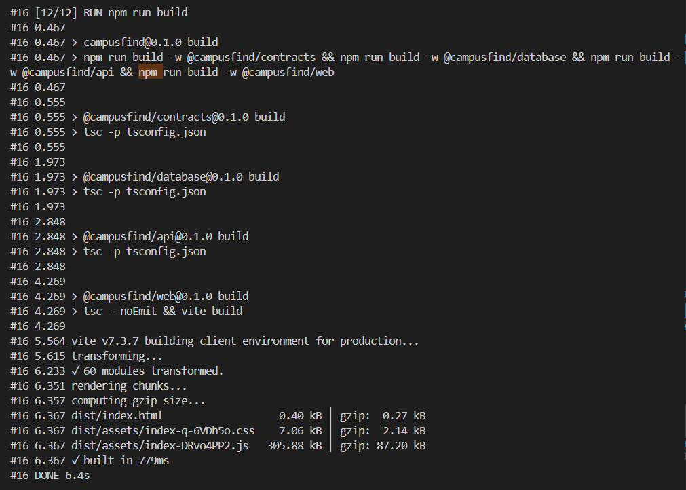

# Лаборатори 8 — Dockerfile, image ба container

**Баг:** 9 · **Төсөл:** CampusFind / SWDP-2026-team9  
**Огноо:** 2026-10-31  
**Орчин:** Windows, PowerShell, Docker 29.9.2, Docker Compose v5.6.1, `node:24-bookworm-slim`  

## Зорилго

CampusFind төслийн Dockerfile-ийг бичиж image бүтээх, container ажиллуулах, source код өөрчлөгдөхөд layer caching хэрхэн ашиглагдахыг ажиглах. Дараагийн шатанд Docker Compose ашиглан frontend, API, PostgreSQL болон Mailpit-ийг хамт ажиллуулж баталгаажуулна.

## Л.Ирмүүн — Image, дан web container, layer caching

**Branch:** `lab08/irmuun-image`

### Хийсэн ажил

1. Docker болон Compose-ийн хувилбарыг шалгаж, Docker орчныг бэлтгэсэн.
2. `backend/src/main.ts`-д API сонсох хаягийг `process.env.HOST ?? '127.0.0.1'` болгосон. Startup log-д мөн энэ хаягийг харуулдаг болгосон. Dockerfile-д `ENV HOST=0.0.0.0` өгч container-ийн сүлжээнээс хандах тохиргоог бэлтгэсэн.
3. Root `.dockerignore` үүсгэж `.git`, `node_modules`, `dist`, `.env`, log, uploads болон labs хавтсыг build context-оос хассан.
4. Root `Dockerfile` үүсгэсэн. Node 24 суурь image дээр root болон workspace package manifest-уудыг эхэлж хуулж, `npm ci` ажиллуулсан. Дараа нь source кодыг хуулж, Prisma client үүсгэн contracts → database → API → frontend build хийсэн.
5. `campusfind:lab08` image бүтээж, command override ашиглан дан frontend container ажиллуулсан. Компьютерийн `15173` портыг container-ийн `5173` порттой холбож, browser дээр `http://localhost:15173` хаягаар web хуудсыг шалгасан.
6. `HomePage.tsx`-ийн харагдах бичвэрт түр өөрчлөлт хийж image-ийг дахин build хийсэн. Шинэ image-ээс web container-ийг дахин үүсгэж өөрчлөлтийг шалгасан. Туршилтын дараа бичвэрийг анхны утгад буцааж, image-ийг дахин бүтээн, түр web container-ийг зогсоож устгасан.

### Гол командууд

```powershell
docker build --progress=plain -t campusfind:lab08 .
docker run -d --name campusfind-lab08-web-run -p 127.0.0.1:15173:5173 campusfind:lab08 npm run dev -w @campusfind/web -- --host 0.0.0.0
docker logs campusfind-lab08-web-run
docker stop campusfind-lab08-web-run
docker rm campusfind-lab08-web-run
```

### Layer caching-ийн ажиглалт

| Алхам | Ажигласан үр дүн | Тайлбар |
| --- | --- | --- |
| `RUN PRISMA_SKIP_POSTINSTALL_GENERATE=true npm ci` | `CACHED` | Dependency manifest-ууд өөрчлөгдөөгүй тул install layer-ийг дахин ашигласан. |
| `COPY . .` | `DONE 0.0s` | Source файл өөрчлөгдсөн тул хуулах алхам дахин ажилласан. |
| `RUN npm run build` | Build log гарч, `DONE 6.4s` болсон | Source COPY-ийн дараах build алхмыг дахин гүйцэтгэсэн. |

Dependency суулгах алхмыг source хуулах алхмын өмнө байрлуулснаар UI-ийн бичвэр өөрчлөгдөхөд dependency-г дахин суулгах шаардлагагүй байв. Түр өөрчилсөн `HomePage.tsx`-ийн одоогийн diff хоосон байна.

### Нотолгоо ба шалгалтын төлөв



Хадгалсан зурагт `RUN npm run build` алхам `DONE 6.4s` болж дууссан нь харагдана. Cache ажиглалтад `npm ci`-ийн `CACHED`, `COPY . .`-ийн `DONE 0.0s` гаралтыг мөн шалгасан.

- Image build, дан web container болон cache туршилт: гүйцэтгэсэн.
- Дан web шалгалтын үед API/DB/SMTP ажиллуулаагүй тул бүртгэл, нэвтрэлтийн нэгдсэн урсгалыг энэ шатанд баталгаажуулаагүй.
- `git diff --check`: алдаагүй.
- `npm run check`, `npm test`: 4.9-р алхамд ажиллуулж үр дүнг нэмнэ.
- Commit/PR: 4.9-р алхмын дараа холбоосыг нэмнэ. Дээрх өөрчлөлтүүд одоогоор суурь commit дээрх ажлын өөрчлөлтүүд болно.

## Э.Амарболд — Compose ба өгөгдлийн сан

**Төлөв:** Гүйцэтгэлийн хэсгийг бөглөөгүй.

- Хийсэн ажил: [Compose-ийн api, web, postgres, mailpit сервисүүд, сүлжээ, healthcheck].
- Шалгалт: [migration, дан API docker run/logs, readiness, нийт check/test-ийн бодит үр дүн].
- Илэрсэн алдаа ба засвар: [байвал бичнэ].
- Commit/PR: [холбоос].

## Г.Нармандах — Backend ба нэгдсэн баталгаажуулалт

**Төлөв:** Гүйцэтгэлийн хэсгийг бөглөөгүй.

- Нягталсан/зассан зүйл: [backend HOST, DB/SMTP тохиргоо, бодит засвар].
- Integration тест: [тусдаа campusfind_test DB дээрх бодит үр дүн].
- UI шалгалт: [register → Mailpit verify → login → logout].
- Аппын нотолгоо: [../lab08/evidence/01-app-running.png зургийг авч холбоно].
- Check/test/CI: [бодит үр дүн, ажиллуулаагүй бол шалтгаан].
- Commit/PR: [холбоос].

## Одоогийн дүгнэлт

CampusFind-ийн image-ийг бүтээж, дан frontend container ажиллуулан source өөрчлөлтийн дараах layer caching-ийг ажигласан. Dependency manifest-уудыг source-оос өмнө хуулснаар `npm ci` layer кэшээс ашиглагдаж, source COPY болон app build дахин ажилласан. Compose, PostgreSQL migration, бодит SMTP/auth урсгал болон integration шалгалтын үр дүнг холбогдох гишүүд ажлаа дуусгасны дараа нэмж, багийн эцсийн дүгнэлтийг нэгтгэнэ.
