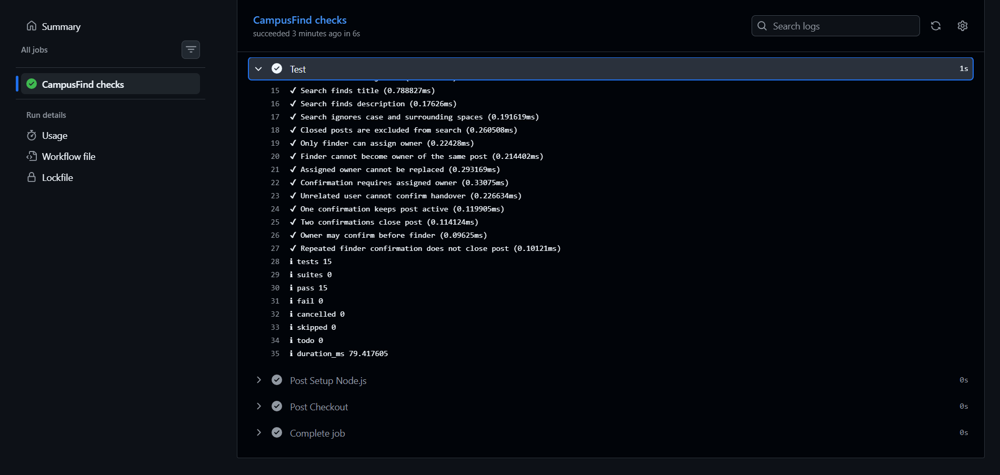
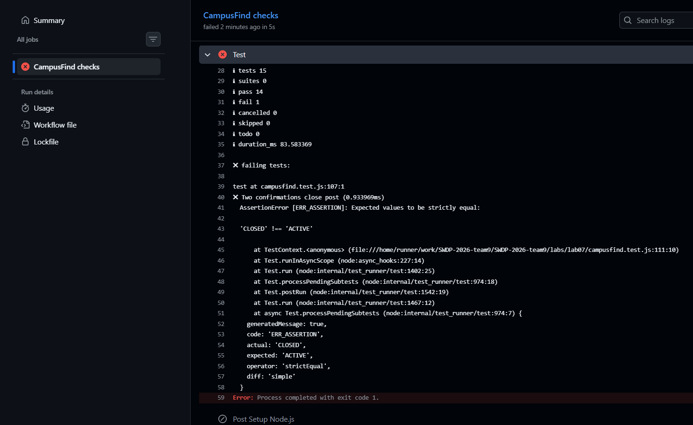

# Лаборатори 7 GitHub Actions CI Pipeline

## Зорилго

CampusFind төслийн жижиг Node.js модульд GitHub Actions ашиглан
push болон Pull Request дээр автомат шалгалт ажиллуулах CI pipeline байгуулав.

## Жишиг төсөл

Лаб 1, 2-ын шаардлага болон Лаб 3-ын backlog-д тулгуурлан дараах
үйлдлүүдийг хэрэгжүүлсэн:

- Олдсон эд зүйлийн зар үүсгэх.
- Идэвхтэй зарыг нэр, тайлбараар хайх.
- Олсон хүн эзэмшигчийг тэмдэглэх.
- Олсон хүн болон эзэмшигч шилжүүлгийг тус тус баталгаажуулах.
- Хоёр тал баталгаажуулсны дараа зар хаах.

Өгөгдөл санах ойд ажиллана. Энэ жишээнд веб интерфейс,
нэвтрэлт болон өгөгдлийн сан хэрэгжүүлээгүй.

## Ашигласан хэрэгсэл

- Node.js 24
- npm
- Node.js-ийн node:test болон assert/strict
- GitHub Actions
- Git болон VS Code

## Local дээр шалгах

Дараах командуудыг репозиторийн үндсэн хавтас дотроос ажиллуулна:

```bash
npm --prefix labs/lab07 ci
npm --prefix labs/lab07 run check
npm --prefix labs/lab07 test
```

Зөв хувилбарын үр дүн:

```text
tests 15
pass 15
fail 0
```

## CI workflow

Workflow файл: `.github/workflows/ci.yml`

Trigger: `push`, `pull_request`

Үндсэн дөрвөн алхам:

1. Checkout — репозиторийн кодыг runner руу татна.
2. Setup Node.js — Node.js 24 орчин бэлтгэнэ.
3. Install — npm ci ажиллуулна.
4. Test — npm run check болон npm test ажиллуулна.

Run командууд `labs/lab07` хавтас дотор ажиллана.

## Санаатай алдаа үүсгэсэн туршилт

`Two confirmations close post` тестийн хүлээгдэж буй
`CLOSED` утгыг зориуд `ACTIVE` болгож өөрчилсөн.

Үндсэн код хоёр тал баталгаажуулсны дараа зарыг зөвөөр
`CLOSED` болгосон боловч тест `ACTIVE` гэж хүлээсэн тул
AssertionError үүссэн.

```text
actual: CLOSED
expected: ACTIVE
tests 15
pass 14
fail 1
exit code 1
```

Дараа нь хүлээлтийг `CLOSED` болгон сэргээж push хийхэд
бүх 15 тест дахин амжилттай болсон.

## CI үр дүн

| Хувилбар | Push run | PR run | Үр дүн |
|---|---|---|---|
| Анхны зөв хувилбар | [39152345338](https://github.com/IrmuunSolo/SWDP-2026-team9/actions/runs/39152345338) | [39152819440](https://github.com/IrmuunSolo/SWDP-2026-team9/actions/runs/39152819440) | Success |
| Зориуд унагасан | [39153300979](https://github.com/IrmuunSolo/SWDP-2026-team9/actions/runs/39153300979) | [39153306100](https://github.com/IrmuunSolo/SWDP-2026-team9/actions/runs/39153306100) | Failure |
| Зассан хувилбар | [39153610291](https://github.com/IrmuunSolo/SWDP-2026-team9/actions/runs/39153610291) | [39153614207](https://github.com/IrmuunSolo/SWDP-2026-team9/actions/runs/39153614207) | Success |

## Нотлох зургууд

### Амжилттай ажиллуулалт



### Амжилтгүй ажиллуулалт



## Дүгнэлт

Push болон Pull Request дээр шалгалт автоматаар ажиллаж байгааг батлав.
Нэг тестийн хүлээлтийг зориуд буруу болгосноор CI алдааг илрүүлж,
Test алхам exit code 1-тэй дууссан. Зөв хүлээлтийг сэргээсний дараа
бүх тест амжилттай болсон.

Pull Request: https://github.com/IrmuunSolo/SWDP-2026-team9/pull/22